# Diagnóstico arquitectónico — Sesión 09 (pre-work)

> Observaciones en español; comandos, payloads y nombres de campo en inglés.

---

## 1. Diagrama de la arquitectura actual

Al cierre de S08 hay **un** proceso FastAPI. Streamlit ya obtiene una estimación por `POST /api/v1/estimate` y `POST /sessions/{id}/estimate` → `llm_service` / sessions → `EstimationResult`. En el mismo proceso existen `POST /embeddings/ingest` (`ingest_service` → `OpenAIEmbedder` → pgvector) y `POST /search` (`SemanticRetriever` + `embed_one` → chunks + `distance`). Nada de Streamlit llama a esos dos endpoints; el camino RAG termina en la lista de chunks. No hay flecha retrieval → estimación. Ahí acaba lo implementado.

Source: `docs/arquitectura-actual.mmd`.



---

## 2. Trace anotado de `02_ambiguous.txt`

> Trace manual a través del sistema tal como está. Para cada paso: la llamada ejecutada, la
> respuesta cruda y un comentario de una o dos frases.

### Paso 1 — Embeber la transcripción completa

From `ai-engineering/` (stack up; `OPENAI_API_KEY` from `estimador-cag/.env`):

```bash
set -a && source estimador-cag/.env && set +a
uv run estimador-cag/scripts/s09/trace_s09.py examples/transcripts/02_ambiguous.txt
```

This run (VS Code **Python: current file**): same transcript and same host `.venv`; the open file was `ai-engineering-lidr/examples/trace_s09.py`. `/search` hit `http://localhost:8000`. Numbers below are from that live process.

| field | value |
|---|---|
| model | `text-embedding-3-small` |
| dimensionality | 1536 |
| L2 norm | 0.999691 |
| first component | 0.006233 |
| last component | 0.019012 |

Un solo vector (norma ≈ 1, ya normalizado) representa la reunión entera: tienda gourmet + web + puntos/club + panel + pago con tarjeta + correo + “decidme un número”. No es “e-commerce” ni “panel”: es el centroide de todos esos encargos mezclados.

### Paso 2 — Búsqueda semántica (top-5)

Same process, step 2 of the script. Equivalent call:

```bash
curl -s -X POST http://localhost:8000/search \
  -H "Content-Type: application/json" \
  --data-binary @- <<'JSON'
{"query": "<full text of 02_ambiguous.txt>", "k": 5}
JSON
```

`search_time_ms`: 318. `results`: 5 (not empty). The four first hits are line-items of the same historical budget (`BUD-2024-005`, sector `ecommerce`, headless storefront). The fifth is a fashion returns portal (`BUD-2024-008`). Output stops at chunks + cosine `distance`. No estimate.

```json
{
  "query": "Reunión exploratoria — sin título claro todavía\nCliente: Rubén Castaño (gerente, Casa Castaño — tienda de productos gourmet)\nConsultor: equipo de estimación\nFecha: primera toma de contacto\n\n[00:00:08] Consultor: Buenas, Rubén. Cuéntame, ¿qué os ronda por la cabeza?\n\n[00:00:15] Rubén: Pues mira,es que llevamos dándole vueltas un tiempo y no sé muy bien por dónde\nempezar, por eso os hemos llamado.Tenemos la tienda física de toda la vida, la de mi padre, llevamos\ncon ella desde el noventa y dos. Conservas, vinos, aceite, esas cosas. Y claro, vemos que el mundo va\npor otro lado y que hay que dar el salto, pero no tenemos ni idea de tecnología, ¿eh?, te lo digo ya.\n\n[00:01:02] Consultor: Sin problema, para eso estamos. ¿Qué te gustaría conseguir?\n\n[00:01:09] Rubén: A ver, lo ideal sería vender por internet, eso seguro. Que la gente entre, vea los\nproductos y compre, ¿no? Pero también... mira, mi sobrina, que de esto sabe más que yo, me dice que\nlo importante hoy es fidelizar. Que un cliente que repite vale más que diez que vienen una vez. Y yo\npienso, pues igual algo de puntos, o un club, no sé, que la gente acumule y luego canjee. Eso me\ngustaría. Aunque tampoco quiero liarlo mucho al principio, ¿eh?\n\n[00:02:05] Consultor: Vale. ¿Y cómo te imaginas el día a día gestionándolo?\n\n[00:02:12] Rubén: Pues eso es lo otro. Yo necesito ver qué se vende. Un panel, algo donde yo entre\npor la mañana con el café y vea los pedidos del día, lo que más se mueve, el stock... que ahora lo\nllevo en un cuaderno, te lo juro. Mi mujer me dice que parezco del siglo pasado. Algo visual, con sus\ngráficas, para tomar decisiones. Eso lo veo clarísimo, lo del panel de control.\n\n[00:03:01] Rubén: Ah, y oye, una cosa importante: que la gente puedapagar con tarjeta, claro. Eso es\nfundamental, que el pago sea fácil y seguro, que no se me vayan en el último paso. He oído que mucha\ngente llena el carrito y luego no paga, y eso no puede ser.\n\n[00:03:40]Consultor: Totalmente. ¿Tenéis volumen previsto, mercados, algo de eso?\n\n[00:03:47] Rubén: Uf, pues nosabría decirte. España de momento, supongo. Aunque un primo en Francia\nme dice que allí los productos españoles se venden solos, así que quién sabe, igual más adelante.\nPero no me hagas mucho caso con eso. Ymira, también pensaba... no sé si es mucho pedir, pero estaría\nbien mandar un correo cuando alguien compra, para que sepa que va su pedido. Detalles, ¿sabes? Que el\ncliente se sienta atendido como en la tienda de siempre.\n\n[00:04:35] Rubén: En fin, que tampoco quiero marearos. Que sé que esto es un mundo. Lo que necesito\nes que me digáis vosotros, que sois los que sabéis, qué se puede hacer y más o menos cuántocuesta.\nYo de presupuestos de software ni idea, ¿eh? Decidme un número y vemos.\n\n[00:05:02] Consultor: Tranquilo, Rubén, lo recogemos y te volvemos con una propuesta. Gracias.\n",
  "k": 5,
  "search_time_ms": 318,
  "results": [
    {
      "chunk_id": 16,
      "document_id": 5,
      "chunk_type": "budget_component",
      "content": "[Project: Headless e-commerce storefront with personalized recommendations]\n[Client sector: ecommerce | Year: 2024 | Main tech: node]\n\nComponent: Product catalog API\nDescription: GraphQL catalog API with faceted search, inventory availability and multi-currency pricing backed by Elasticsearch.\nTech stack: node, graphql, elasticsearch\nComplexity: medium\nEstimated hours: 150",
      "distance": 0.6082901653998141,
      "metadata": {
        "year": 2024,
        "budget_id": "BUD-2024-005",
        "complexity": "medium",
        "component_id": "CATALOG-001",
        "client_sector": "ecommerce",
        "estimated_hours": 150,
        "main_technology": "node"
      }
    },
    {
      "chunk_id": 17,
      "document_id": 5,
      "chunk_type": "budget_component",
      "content": "[Project: Headless e-commerce storefront with personalized recommendations]\n[Client sector: ecommerce | Year: 2024 | Main tech: node]\n\nComponent: Cart and checkout service\nDescription: Stateless cart service with promotion engine, tax calculation and a checkout orchestration that integrates the payment provider.\nTech stack: node, redis, postgresql\nComplexity: high\nEstimated hours: 140",
      "distance": 0.6137590645666313,
      "metadata": {
        "year": 2024,
        "budget_id": "BUD-2024-005",
        "complexity": "high",
        "component_id": "CART-002",
        "client_sector": "ecommerce",
        "estimated_hours": 140,
        "main_technology": "node"
      }
    },
    {
      "chunk_id": 18,
      "document_id": 5,
      "chunk_type": "budget_component",
      "content": "[Project: Headless e-commerce storefront with personalized recommendations]\n[Client sector: ecommerce | Year: 2024 | Main tech: node]\n\nComponent: Personalized recommendations\nDescription:Collaborative-filtering recommendations served from a feature store and exposed as a low-latency API forproduct and cart pages.\nTech stack: node, redis\nComplexity: medium\nEstimated hours: 110",
      "distance": 0.637252935647824,
      "metadata": {
        "year": 2024,
        "budget_id": "BUD-2024-005",
        "complexity": "medium",
        "component_id": "RECO-003",
        "client_sector": "ecommerce",
        "estimated_hours": 110,
        "main_technology": "node"
      }
    },
    {
      "chunk_id": 19,
      "document_id": 5,
      "chunk_type": "budget_component",
      "content": "[Project: Headless e-commerce storefront with personalized recommendations]\n[Client sector: ecommerce | Year: 2024 | Main tech: node]\n\nComponent: Storefront PWA\nDescription: Progressive web app storefront consuming the headless APIs with server-side rendering for SEO.\nTech stack: next_js, react\nComplexity: low\nEstimated hours: 60",
      "distance": 0.6387629636778489,
      "metadata": {
        "year": 2024,
        "budget_id": "BUD-2024-005",
        "complexity": "low",
        "component_id": "STORE-004",
        "client_sector": "ecommerce",
        "estimated_hours": 60,
        "main_technology": "node"
      }
    },
    {
      "chunk_id": 27,
      "document_id": 8,
      "chunk_type": "budget_component",
      "content": "[Project: Fashion returns management and resale portal]\n[Client sector: ecommerce | Year: 2023 | Main tech: dotnet]\n\nComponent: Returns portal\nDescription: Self-service returns portal with label generation, reason capture and automatic restock or resale routing.\nTech stack: dotnet, sqlserver\nComplexity: medium\nEstimated hours: 140",
      "distance": 0.6443924190186967,
      "metadata": {
        "year": 2023,
        "budget_id": "BUD-2024-008",
        "complexity": "medium",
        "component_id": "RET-001",
        "client_sector": "ecommerce",
        "estimated_hours": 140,
        "main_technology": "dotnet"
      }
    }
  ]
}
```

### Paso 3 — Lectura de los chunks devueltos

Encargo Casa Castaño (tienda gourmet): web para vender + puntos/club + panel de pedidos/stock + pago con tarjeta. Si un hit cubre una de esas cuatro y no inventa otro producto, es parcial. Si es otro producto, no.

| rank | `chunk_id` | `budget_id` | `client_sector` | hours | componente | ¿relevante? |
|---|---|---|---|---|---|---|
| 1 | 16 | `BUD-2024-005` | `ecommerce` | 150 | Product catalog API (GraphQL, Elasticsearch, multi-currency) | **Parcial.** Necesitan catálogo para vender. Este es un headless GraphQL+ES+multidivisa: no es una tienda gourmet que “no tiene ni idea de tecnología”. |
| 2 | 17 | `BUD-2024-005` | `ecommerce` | 140 | Cart and checkout + payment provider | **Parcial (el más cercano).** Rubén pide pago con tarjeta y “llenan el carrito y no pagan”. Checkout/pago encaja. Motor de promos + tax + orquestación stateless es más de lo que pidió. |
| 3 | 18 | `BUD-2024-005` | `ecommerce` | 110 | Personalized recommendations (collaborative filtering) | **No.** Pidió club de fidelización, no un motor de recomendaciones. Otro producto. |
| 4 | 19 | `BUD-2024-005` | `ecommerce` | 60 | Storefront PWA (SSR, headless APIs) | **Parcial.** “Que la gente entre, vea los productos y compre” es una tienda cara al cliente. PWA+SSR+headless es una arquitectura que él no eligió. |
| 5 | 27 | `BUD-2024-008` | `ecommerce` | 140 | Returns portal (moda, reventa) | **No.** No habló de devoluciones. Vertical moda, no gourmet. |

Nada del top-5 habla del panel de control, club de fidelización ni e-mail con el pedido. Los cuatro primeros son líneas del **mismo** presupuesto headless; el quinto es otro proyecto. No hay un total. No hay estimación.

---

## 3. Diagnóstico: cinco fallos identificados

> Cinco fallos concretos y verificables que impiden hoy convertir la transcripción en una
> estimación de calidad. Para cada uno: Problema observado / Causa probable / Propuesta de solución.

### Fallo 1 — Una query aplasta cuatro encargos
- **Problema observado:** El paso 1 embebe el acta entera en un solo vector (1536-d, L2 `0.999691`). El paso 2, con esa misma acta como `query`, devuelve cinco trozos de “e-commerce storefront” / cart / reco / PWA / returns. Cero hits de panel de control, club de fidelización o mail de pedido. Distancias `0.608`–`0.644`.
- **Causa probable:** Cliente y `SemanticRetriever.search` (`retriever.py`) hacen `embed_one` del texto completo y un k-NN. El centroide lo gana “vender por internet”; el resto de la reunión se diluye.
- **Propuesta de solución:** Una pieza que parta el acta en encargos (web, fidelización, panel, pago) y recupere **por encargo**, no un único punto.

### Fallo 2 — `client_sector` viaja en el hit y nadie lo usa
- **Problema observado:** Los cinco `metadata.client_sector` son `ecommerce`. Casa Castaño es tienda gourmet física. No aparece ningún vecino de retail/gourmet.
- **Causa probable:** `ChunkStore.search` (`repository.py`) ordena por distancia y hace `LIMIT k`. No hay `WHERE` sobre `metadata`. El retriever lo declara: “no metadata filtering”. El índice GIN existe; la query de `/search` no lo toca.
- **Propuesta de solución:** Filtro o boost por `client_sector` (y el resto de `metadata`) antes o después del k-NN.

### Fallo 3 — El hit es una línea, no un presupuesto
- **Problema observado:** Los cinco `chunk_type` son `budget_component`. Ranks 1–4 = cuatro líneas de `BUD-2024-005` (150+140+110+60 h). Rank 5 = una línea de `BUD-2024-008`. No hay total, no hay presupuesto completo.
- **Causa probable:** El ingest escribe un chunk por componente (`BUDGET_COMPONENT` en `repository.py`). `/search` devuelve componentes. Nadie agrupa por `budget_id`.
- **Propuesta de solución:** Recuperar o agregar a nivel de presupuesto: o un chunk-resumen por `budget_id`, o un rollup que junte los hermanos del mismo presupuesto.

### Fallo 4 — El vecino semántico no es el encargo
- **Problema observado:** `chunk_id` 18 = recomendaciones por collaborative filtering (pidió puntos/club). `chunk_id` 27 = portal de devoluciones de moda (no lo mencionó). Los dos están en el top-5.
- **Causa probable:** Coseno sobre el vector mezclado, sin rerank y sin acotar tipo de componente. “Fidelizar” / “carrito” empujan hacia el motor de recomendaciones y hacia un portal de devoluciones.
- **Propuesta de solución:** Un rerank o un filtro que puntúe cada hit contra los encargos extraídos del acta y descarte lo que no sea el trabajo pedido.

### Fallo 5 — `/search` se acaba en la lista
- **Problema observado:** El JSON del paso 2 es `chunks` + `distance` + `metadata`. No hay horas totales ni `EstimationResult`. La sección 1 ya marca que no hay flecha retrieval → estimación.
- **Causa probable:** `POST /search` responde `SearchResponse` (lista). Después de `SemanticRetriever` no hay ensamblado ni generación. Streamlit estima por otro camino (`llm_service` / sessions).
- **Propuesta de solución:** Una pieza de ensamblado/generación que consuma los hits (ya filtrados) y produzca la estimación que la UI ya sabe pintar.

### Otros

- Las distancias `0.61`–`0.64` no son cercanas (0 = idéntico). El “mejor” vecino ya es un match flojo.
- No hay endpoint de encode: para ver el vector del paso 1 hubo que llamar a OpenAI desde el cliente; `/search` embebe por dentro y no lo enseña.
- El top-4 se desploma sobre un solo proyecto histórico (`BUD-2024-005`): poca diversidad.

---

## 4. Propuesta de evolución arquitectónica

> Segundo diagrama de la misma arquitectura de tres capas, con las cajas/módulos que añadirías para
> cerrar el flujo transcripción → estimación generada. Marca claramente lo NUEVO respecto a la
> sección 1.

Source: `docs/arquitectura-propuesta.mmd`.



Hay tres módulos nuevos (en rojo). El retriever no es uno de ellos: ya estaba. Lo que cambia es que ahora puede volver con las manos vacías, y entonces no se llama a nadie más.

- **`query_reformulator`.** Recibe el acta que entra por `/estimate`. Su trabajo es traducir esa conversación en una ficha (`EstimationQuery`): qué hay que construir, con qué y para quién. Esa ficha se la pasa al retriever, para que busque con un texto corto y con filtros, y también a `llm_service`, para que sepa qué está estimando.
- **`budget_assembler`.** Recibe del retriever las líneas sueltas que sí se parecen a esa ficha. Como una línea no es un presupuesto, va a pgvector y trae el caso histórico entero (todas las líneas de ese `budget_id`). Ese paquete se lo entrega a `context_assembler`. Si el retriever no encontró nada decente, este paso no se ejecuta.
- **`context_assembler`.** Recibe esos presupuestos ya completos. Los envuelve en etiquetas para que se vea de qué caso histórico es cada trozo y no se mezclen. Ese bloque etiquetado se lo pasa a `llm_service`, que es quien escribe el `EstimationResult` que Streamlit ya sabe pintar.

Si solo pudiera construir una pieza, sería **`query_reformulator`**. En el trace buscamos con el acta tal cual y salieron cuatro líneas de una tienda headless y un portal de devoluciones: ni el panel de control ni el club de fidelización que pidieron. Rearmar presupuestos y etiquetar trozos no arregla eso; solo dejan más ordenados unos vecinos que no eran el encargo. Primero hace falta una ficha que el retriever pueda usar.
