# Diagnóstico arquitectónico — Sesión 09 (pre-work)

> Observaciones en español; comandos, payloads y nombres de campo en inglés.

---

## 1. Diagrama de la arquitectura actual

Al cierre de S08 hay **un** proceso FastAPI. Streamlit ya obtiene una estimación por `POST /api/v1/estimate` y `POST /sessions/{id}/estimate` → `llm_service` / sessions → `EstimationResult`. En el mismo proceso existen `POST /embeddings/ingest` (`ingest_service` → `OpenAIEmbedder` → pgvector) y `POST /search` (`SemanticRetriever` + `embed_one` → chunks + `distance`). Nada de Streamlit llama a esos dos endpoints; el camino RAG termina en la lista de chunks. No hay flecha retrieval → estimación. Ahí acaba lo implementado.

```mermaid
flowchart TB
    subgraph CLIENTS["① Clientes"]
        ClientsW1["estimación actual · llm_service / sessions"]
        ClientsW2["SemanticRetriever k-NN cosine"]
        UI["Streamlit<br/>New · Conversational · Recent · Chunking Lab · Ajustes"]
        HTTP["curl / Postman / scripts/s09/trace_s09.py"]
    end

    subgraph API["② API — src/routers (transporte)"]
        EpEst["POST /api/v1/estimate<br/>POST /sessions/{id}/estimate"]
        EpIngest["POST /embeddings/ingest"]
        EpOther["compare · config · ingestion"]
        EpSearch["POST /search"]
    end

    subgraph SVC["③ Servicios — un proceso"]
        subgraph COL_EST[" "]
            Est["estimación actual<br/>llm_service / sessions"]
            Result["EstimationResult"]
        end

        subgraph COL_RAG[" "]
            Ingest["ingest_service"]
            Embed["OpenAIEmbedder 1536d"]
            Retr["SemanticRetriever k-NN cosine"]
            Store[("pgvector documents + chunks")]
        end

        subgraph COL_OUT[" "]
            Chunks["chunks + distance"]
        end

        subgraph FLOOR[" "]
            FloorNote["⛔ sin flecha a la estimación"]
            FloorR[" "]
        end
    end

    UI --> EpEst --> Est --> Result
    UI --> EpOther
    HTTP --> EpSearch --> Retr
    HTTP --> EpIngest --> Ingest
    Ingest --> Embed --> Store
    Retr -->|"embed_one(query)"| Embed
    Retr -->|"k-NN"| Store
    Store --> Retr
    Retr --> Chunks

    Chunks -.-> FloorR
    FloorR -.-> FloorNote
    FloorNote -.-> Result

    style COL_EST fill:none,stroke:none
    style COL_RAG fill:none,stroke:none
    style COL_OUT fill:none,stroke:none
    style FLOOR fill:none,stroke:none
    style FloorR fill:none,stroke:none,color:transparent
    style ClientsW1 fill:none,stroke:none,color:transparent
    style ClientsW2 fill:none,stroke:none,color:transparent
```

---

## 2. Trace anotado de `02_ambiguous.txt`

> Trace manual a través del sistema tal como está. Para cada paso: la llamada ejecutada, la
> respuesta cruda y un comentario de una o dos frases.

### Paso 1 — Embeber la transcripción completa

_(comando + vector: dimensionalidad/norma, primera y última componente + comentario)_

### Paso 2 — Búsqueda semántica (top-5)

_(comando + respuesta cruda con chunks y distancias)_

### Paso 3 — Lectura de los chunks devueltos

_(para cada chunk: presupuesto histórico, sector, ¿relevante? Sé honesto.)_

---

## 3. Diagnóstico: cinco fallos identificados

> Cinco fallos concretos y verificables que impiden hoy convertir la transcripción en una
> estimación de calidad. Para cada uno: Problema observado / Causa probable / Propuesta de solución.

### Fallo 1 — _(título)_
- **Problema observado:**
- **Causa probable:**
- **Propuesta de solución:**

### Fallo 2 — _(título)_
- **Problema observado:**
- **Causa probable:**
- **Propuesta de solución:**

### Fallo 3 — _(título)_
- **Problema observado:**
- **Causa probable:**
- **Propuesta de solución:**

### Fallo 4 — _(título)_
- **Problema observado:**
- **Causa probable:**
- **Propuesta de solución:**

### Fallo 5 — _(título)_
- **Problema observado:**
- **Causa probable:**
- **Propuesta de solución:**

### Otros _(opcional)_

---

## 4. Propuesta de evolución arquitectónica

> Segundo diagrama de la misma arquitectura de tres capas, con las cajas/módulos que añadirías para
> cerrar el flujo transcripción → estimación generada. Marca claramente lo NUEVO respecto a la
> sección 1.

_(diagrama aquí)_

> Párrafo (≤10 líneas): responsabilidad de cada módulo nuevo, qué dato fluye entre ellos, y qué
> pieza es la más crítica — la que atacarías primero si solo pudieras construir una.
