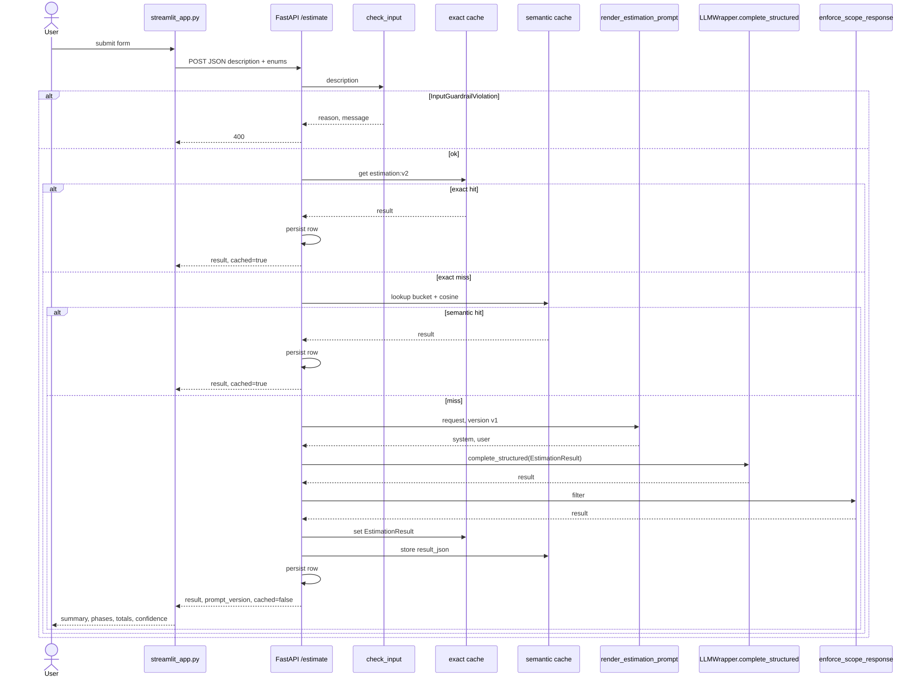
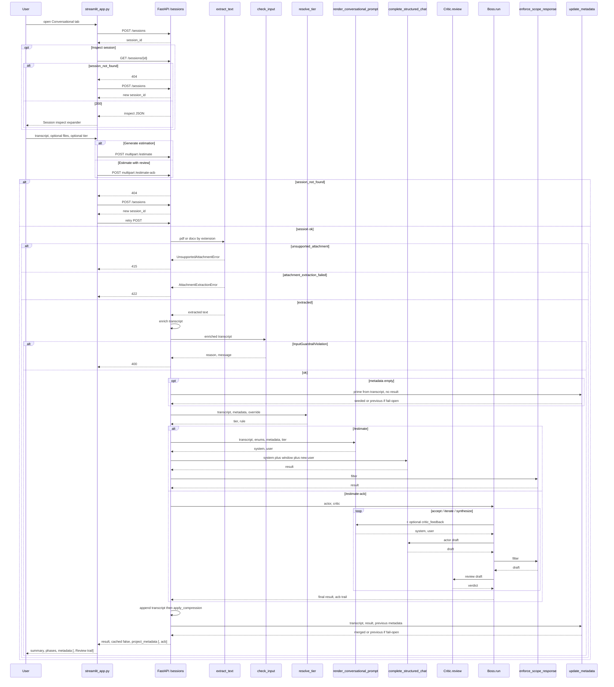
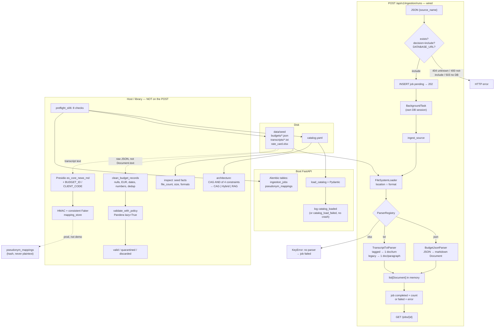

# Estimador CAG — Software estimation with AI

AI-powered software project estimation service using a **Cache Augmented Generation (CAG)** architecture.

The design and reference implementation this project follows come from the LiDR / Master **estimator** service (`ai-engineering-lidr/estimator`). This repo is a parallel student implementation with the same CAG approach.

## What is CAG and why use it

CAG (Cache Augmented Generation) injects relevant context directly into the LLM system prompt as static text. Live few-shot examples live in the Jinja templates (`prompts/estimation/v1|v2/examples.j2`) — no vector store and no retrieval step.

That is a good first stage because:

- It is simple to implement and debug
- CAG itself needs no extra infrastructure; embeddings live on a separate endpoint (`POST /embeddings/ingest`), not on the CAG path
- It works well when the context volume is small (a handful of examples)

Later modules of the Master are expected to evolve this kind of service toward **RAG** (Retrieval Augmented Generation) with a vector store when the example set grows.

## Requirements

- Python **3.11+**
- [uv](https://docs.astral.sh/uv/)
- An **API key** for OpenAI and/or Anthropic (at least one). There is no provider fallback: calls go to `PRIMARY_MODEL` only
- **Redis** if you want exact-match cache; **Redis Stack** (RediSearch) if you also want semantic cache (the API still answers if Redis is down; semantic cache also needs an OpenAI key)

## Local setup

Dependencies are declared in `pyproject.toml` and locked in `uv.lock`. `uv sync` installs that set into `.venv`.

```bash
cd estimador-cag
uv sync
cp .env.example .env
# Edit .env and set the API key for your chosen provider
```

Run the API (app package root is `src/`):

```bash
cd src
uv run uvicorn main:app --reload
```

Service: `http://localhost:8000`  
Swagger: `http://localhost:8000/docs` · ReDoc: `http://localhost:8000/redoc` · Health: `GET /health`

## Docker

```bash
cd estimador-cag
cp .env.example .env   # if needed
docker compose up --build
```

- API: [http://localhost:8000](http://localhost:8000)
- Redis Stack: `redis://localhost:6379` · RedisInsight: [http://localhost:8001](http://localhost:8001)
- Postgres: `localhost:5432` (user/password/db `postgres` / `postgres` / `estimator`)

Compose sets `REDIS_URL=redis://redis:6379` for the API container. When you run uvicorn on the host, keep `redis://localhost:6379` in `.env`.

Streamlit still runs on the host (not inside Compose):

```bash
uv run streamlit run streamlit_app.py          # New / Conversational / Recent — API must be up
```

## Logs

### History
```bash
docker logs estimator
```

### Live, next submit
```bash
docker logs -f estimator       
```

## CAG stress

Live eval of the conversational CAG. Real `gpt-4o-mini` (OpenAI only; Anthropic is not on this path). Not pytest. Burns credit — check the OpenAI dashboard before and after.

The runner writes `evals/stress/results.csv` (gitignored). You fill `evals/stress/REPORT.md` by hand from that CSV. The runner does not write the report.

Full matrix: 3 scenarios × 5 attachment sizes × 3 repeats × 20 turns = 900 turns if every call succeeds. Floor is ≥50 CSV rows; do not shrink the 20-turn scripts to hit it.

### Stress fixtures

```bash
cd estimador-cag
PYTHONPATH=src:. uv run python -m evals.stress.fixtures.build_pdfs
```

Writes `attach_{5,20,50,100}kb.pdf` under `evals/stress/fixtures/`. Deterministic. Gitignored.

### Stress server up

API must already be running (Compose or uvicorn). Same stack as [Docker](#docker).

```bash
cd estimador-cag
docker compose up --build -d
curl -sf http://localhost:8000/health
```

### Stress run

```bash
cd estimador-cag
PYTHONPATH=src:. uv run python -m evals.stress.run \
    --http http://localhost:8000 \
    --scenarios growing,pivot,contradiction \
    --attachment-sizes 0,5,20,50,100 \
    --repeats 3 \
    --output evals/stress/results.csv
```

### Stress report

Open `evals/stress/results.csv` (or the summary the runner prints) and replace the `_xxx_` placeholders in `evals/stress/REPORT.md`. Commit the report, not the CSV.

## HTTP client

Streamlit is the HTTP client of the estimator API. It never talks to SQL, Redis, or the LLM.

### Streamlit (HTTP form)

Needs the API running. Three tabs:

- **New estimation** — one-shot. Submit sends `description` plus the three enums as JSON to `POST /api/v1/estimate` and paints `result` (summary, phases, totals, confidence). A 400 from input guardrails is shown as `reason` + `message`.
- **Conversational** — brought forward so the session API can be used without Swagger. Entering the tab calls `POST /sessions` once and keeps `session_id` in `st.session_state`. The caption states the API default prompt is **v3**. The form has an optional audience-tier select (`auto` omits the field) and two submits: **Generate estimation** → `POST /sessions/{id}/estimate`, **Estimate with review** → `POST /sessions/{id}/estimate-acb`. If the body has `acb`, an expander **Review trail** shows iterations. **Inspect session** sits outside the form and `GET`s the session JSON into a **Session inspect** expander (spinner, not the flashy wait). Submit does not GET. 404 on estimate restarts the session and retries the POST; 404 on inspect starts a new session, keeps `conv_result` / `conv_inspect`, and does not retry the GET. The API extracts attachment text locally (pypdf / python-docx). Caches stay off and nothing is written to Postgres. Each turn sends a rebuilt system prompt (current `project_metadata`) plus a sliding window of prior user/assistant pairs (max 6). On an empty session the extractor primes facts before the estimate; after every successful estimate it runs again. The response carries `project_metadata`. Leaving the tab does not drop the session. **New conversation** confirms and creates another `session_id` (also clears inspect).
- **Recent** — last 20 rows via `GET /api/v1/estimations`; reopen via `GET /api/v1/estimations/{id}` (one-shot history only).

While a POST is in flight the UI rotates phase labels (Discovery, Design, Implementation, QA, Launch) — wait UX, not SSE.

Two sequences. One-shot is frozen (New / `POST /api/v1/estimate`). Source: `docs/oneshot-sequence.mmd`.



Conversational tab (no cache, no Postgres persist). This one keeps evolving, so it stays inline.



## Conversational sessions

`POST /sessions`, `POST /sessions/{id}/estimate`, `POST /sessions/{id}/estimate-acb`, and `GET /sessions/{id}` are additive. `POST /api/v1/estimate` is unchanged.

Two memories, on purpose:

- **Conversational history** — last ≤ 6 user+assistant pairs in a process-local `SessionStore` dict. The user turn is the enriched transcript (form + attachments), not the rendered `user.j2`. The assistant turn is `EstimationResult.model_dump_json()`. `append` only stores the pair; `CompressionPolicy` peels overflow after that. The system prompt is not stored; it is rebuilt each turn from the current `project_metadata`. Restarting uvicorn empties the dict. This is not `services/history.py` (that table is the one-shot Postgres log, what the Recent tab reads).
- **Project metadata** — durable facts (`project_name`, team size, technologies, scope) kept *outside* the message array and re-injected into `<project_metadata>` every turn. When the window drops turn 1, the name should still be in the system block.

When the window overflows, the oldest pair is peeled. If the user turn matches an anchor (NDA, frozen scope, compliance, …), both messages move to `anchors` and stay verbatim. Otherwise they fold into a cumulative `summary` (`COMPRESSION_MODEL`, fail-open). `to_messages_list()` order: optional summary envelope, then anchors, then the recent window. `ANCHOR_DETECTION_MODE` default is `heuristic`; `llm` classifies the evicted user turn and falls back to heuristic on failure. Memory is still process-local.

Caches stay off on this path (`cached` is always `false`). The same transcript in two sessions is not the same call: history and metadata differ. A cache hit would be a silent wrong answer. Nothing is written to Postgres.

`GET /sessions/{id}` is read-only inspect (window size, metadata, `anchors_count`, `summary_chars`, last resolved tier and rule). It is not a second estimate and does not call the LLM. The estimate response still carries `project_metadata`. No `DELETE /sessions` and no session list. If FastAPI restarted and the id is gone, both GET and estimate return `{"detail": "session_not_found"}`; Streamlit creates a new session and warns.

Each session estimate resolves an audience **tier** (`executive` / `pm` / `developer` / `default`) from an optional multipart `tier` override, else the first matching rule (NDA / regulatory in this turn → executive; ≥2 infra keywords in this turn → developer; saved `assumed_team_size` ≤ 2 → pm). v3 injects that into `<audience>`. `?prompt_version=` still accepted; omitted query uses `CONVERSATIONAL_PROMPT_VERSION` (default **v3**). One-shot `/api/v1/estimate` stays on `render_estimation_prompt`, default v1.

`POST /sessions/{id}/estimate-acb` is the same multipart as `/estimate`, then Actor → Critic → Boss (accept / iterate / synthesize, `BOSS_MAX_ITERATIONS=3`). Response adds `acb` (`iterations`, `final_decision`, `iterations_run`). Intermediate actor drafts are discarded; the session stores one turn (enriched transcript + final assistant). Critic fail-open: accept with review confidence 0. Caches stay off. `{"detail": "session_not_found"}` on a missing id.

### Path B (local PDF/DOCX)

Attachments are extracted **in the API** with `pypdf` and `python-docx` (`src/services/attachments.py`). Dispatch is by filename extension: only `.pdf` and `.docx`. No filename or empty upload: ignored. Unsupported type → 415. Broken file → 422. Text is appended after the form `transcript` as `--- attachment: filename ---`. `transcript` stays 20–2000 characters; extracted text is extra, truncated per file at `MAX_ATTACHMENT_CHARS` (60000), not rejected with 413.

Path A (provider Files API) is out of scope. Local extract keeps the same text path for OpenAI and Anthropic, and we own the truncation. Chunking / retrieval is module 3.

### Metadata extractor

Same Instructor call (`METADATA_EXTRACTOR_MODEL`, default `gpt-4o-mini`), two moments. If metadata is still empty, `prime_metadata_if_empty` runs **before** the estimate (transcript only, no `EstimationResult`) so turn 1 already has facts in `<project_metadata>`. After a successful estimate it runs again with the enriched transcript + `EstimationResult` + previous metadata and returns a partial `ProjectMetadata`. Scalars: non-null wins. Technologies: case-insensitive union.

Fail-open on either call: logged, previous metadata kept. A facts refresh must not 502 the user.

Why a slot instead of asking the estimator to also maintain the object: the window will forget turn 1. Facts have to live outside the message array and be re-injected every turn.

## Project layout

```
estimador-cag/
├── src/
│   ├── main.py                 # FastAPI app, /health
│   ├── config.py               # Pydantic Settings
│   ├── dependencies.py         # wrapper, caches, SessionStore singleton
│   ├── rates.py                # rate card + weekly bands
│   ├── utils.py                # package root path
│   ├── sessions/               # in-process Session + history + store + compression
│   ├── routers/                # /estimate, /sessions, /ingestion
│   ├── prompts/                # estimation/v1|v2|v3 + metadata + conversation_summary + critic
│   ├── guardrails/             # input check (exception) + output filter
│   ├── cache/                  # semantic cache (bucket + cosine)
│   ├── services/               # oneshot, conversational, ACB, attachments, history, prompt_boundary
│   ├── schemas/                # estimation + acb + critic + ingestion
│   ├── ingestion/              # catalog, loaders, parsers, cleaning, pii, orchestrator
│   ├── embedding_pipeline/     # ingest + compare + 8 chunkers (strategies/)
│   └── persistence/            # jobs + mappings repos
├── data/                       # catalog.yaml + seed + budgets_sample.json + test_queries.json
├── alembic/                    # estimations + session6 tables
├── alembic.ini
├── evals/                      # golden dataset, metrics, CLI runner + stress/
├── tests/
├── scripts/                    # preflight_s06, demo_cleaning, demo_pii, compare.py, compare_chunkers.py
├── docs/                       # oneshot sequence + session notes
├── streamlit_app.py            # New + Conversational + Recent
├── Dockerfile
├── docker-compose.yml
├── pyproject.toml
├── uv.lock
└── .env.example
```

# Notes

## Test

### FastAPI

curl -X POST http://localhost:8000/api/v1/estimate \
  -H "Content-Type: application/json" \
  -d '{
    "description": "In the meeting with the marketing team, the client explained they need a landing page with a contact form, integration with their current CRM (HubSpot), and a blog section with a WYSIWYG editor. The ideal deadline would be 4 weeks. The design already exists in Figma.",
    "project_type": "web_saas",
    "detail_level": "medium",
    "output_format": "phases_table"
  }' -o output.json

# Optional: POST /api/v1/estimate?prompt_version=v2  (default is v1)

jq '.result' output.json

### Conversational — two turns (API must already be running)

Default prompt on this path is **v3** (`?prompt_version=` still accepts v1|v2|v3). Optional multipart `tier` overrides the resolver.

```bash
SESSION_ID=$(curl -s -X POST http://localhost:8000/sessions | jq -r .session_id)
echo "$SESSION_ID"

curl -s -X POST "http://localhost:8000/sessions/${SESSION_ID}/estimate" \
  -F "transcript=We will call the project Nimbus. Sales team needs a CRM with contacts, a deal pipeline, and HubSpot import. Team of 3. React + Postgres." \
  -F "project_type=web_saas" \
  -F "detail_level=medium" \
  -F "output_format=phases_table" \
  | jq '{prompt_version, cached, project_metadata, summary: .result.summary}'

# Second turn: do not repeat the project name. Optional file: -F "attachments=@brief.pdf"
curl -s -X POST "http://localhost:8000/sessions/${SESSION_ID}/estimate" \
  -F "transcript=Add a reporting dashboard with weekly pipeline charts for the same team." \
  -F "project_type=web_saas" \
  -F "detail_level=medium" \
  -F "output_format=phases_table" \
  | jq '{prompt_version, cached, project_metadata, summary: .result.summary}'
```

Restarting the API drops the in-memory session; the next estimate returns 404.

### Golden evals (live eval — real model, keys required)

In-process `TestClient` (default) or `--http` against a server already up.
Without keys the prelude returns 503 and the case is an ERROR. The runner
does not skip 503. First live run is for reading FAILs, not 16/16.

```bash
cd estimador-cag
PYTHONPATH=src:. uv run python -m evals.run --mode actor
PYTHONPATH=src:. uv run python -m evals.run --mode acb --limit 5 --output /tmp/acb.json
PYTHONPATH=src:. uv run python -m evals.run --mode actor --http http://localhost:8000
```

### Form HTTP client (API must already be running)
uv run streamlit run streamlit_app.py          # New / Conversational / Recent

## Ingestion

`POST /api/v1/ingestion/runs` catalogs, loads, parses, and writes a job row. It does not clean or pseudonymize.

That job row is the only persistence on this path: `job_id`, `source_name`, `status`, `documents_count`, timestamps in `ingestion_jobs`. It survives the request; `GET /api/v1/ingestion/jobs/{id}` reads it later. The parsed content does not. The orchestrator builds a `list[Document]` in memory (Pydantic, not an ORM table), writes `len(documents)` onto the job, and returns the list. The BackgroundTask never stores that return value. When the task ends, the documents are gone. There is no `documents` table.

```bash
cd estimador-cag
docker compose down -v   # empty volume before the first Alembic upgrade
docker compose up --build -d
curl -sf http://localhost:8000/health
```

Do not `down -v` again unless you intend to wipe `postgres_data` (Recent-tab rows go with it). Compose already runs `alembic upgrade head`.

```bash
curl -sS -X POST http://localhost:8000/api/v1/ingestion/runs \
  -H 'Content-Type: application/json' \
  -d '{"source_name":"presupuestos_json"}'

curl -sS http://localhost:8000/api/v1/ingestion/jobs/<job_id>
```

```bash
# 400 — in the catalog as review / exclude, so no job is created
curl -sS -X POST http://localhost:8000/api/v1/ingestion/runs \
  -H 'Content-Type: application/json' \
  -d '{"source_name":"transcripciones_txt"}'

curl -sS -X POST http://localhost:8000/api/v1/ingestion/runs \
  -H 'Content-Type: application/json' \
  -d '{"source_name":"rate_card_xlsx"}'

# 404 — not in the catalog
curl -sS -X POST http://localhost:8000/api/v1/ingestion/runs \
  -H 'Content-Type: application/json' \
  -d '{"source_name":"no_existe"}'
```

```bash
# custom
curl -sS -X POST http://localhost:8000/api/v1/ingestion/runs \
  -H 'Content-Type: application/json' \
  -d '{"source_name":"presupuestossv_json"}'
```

Host scripts (not in the image). `alembic upgrade head` on the host is for uvicorn-on-the-host:

```bash
cd estimador-cag
PYTHONPATH=src:. uv run alembic upgrade head
uv run python -m spacy download es_core_news_md
PYTHONPATH=src:. uv run python -m ingestion.catalog.inspect data/seed
PYTHONPATH=src:. uv run python -m ingestion.catalog.loader data/catalog/catalog.yaml
PYTHONPATH=src:. uv run python -m ingestion.architecture
PYTHONPATH=src:. uv run python scripts/preflight_s06.py
PYTHONPATH=src:. uv run python scripts/demo_cleaning_s06.py
PYTHONPATH=src:. uv run python scripts/demo_pii_s06.py
```

### Ingestion DFD



## Embeddings pipeline

First step toward semantic search: turn historical budgets (JSON) into vectors. The new module lives in `src/embedding_pipeline/` and exposes `POST /embeddings/ingest` and `POST /embeddings/compare`. **Nothing is persisted yet** — vectors are generated in memory and returned over HTTP.

`POST /embeddings/ingest` does not read `data/seed/`, does not call the ingestion pipeline, and does not write Postgres, Redis, or files. The client sends `{"budgets": [...]}` in the body. The router chunks → OpenAI embeddings → returns `chunks` + `stats` in the HTTP response. Drop the JSON or kill the process and the vectors are gone. Same contract as `src/embedding_pipeline/__init__.py`.

Pieces:

- `chunker.py` (`JSONStructuralChunker`) — **structural** chunking: one budget component = one chunk. Each chunk is prepended with a context header from the parent budget (project, sector, technology) so it does not lose track of whom it belongs to. Token counting with `tiktoken`.
- `embedder.py` (`OpenAIEmbedder`) — calls `text-embedding-3-small` (1536 dims) in **batches** of 100, with exponential retry (1s/2s/4s) on `RateLimitError` and per-batch logging.
- `router.py` — orchestrates `chunk → embed → stats`.

How to debug (cwd `estimador-cag/`, `PYTHONPATH=src`):

```
  import json
  from pathlib import Path
  from embedding_pipeline.schemas import Budget
  from embedding_pipeline.chunker import JSONStructuralChunker
  raw = json.loads(Path('data/budgets_sample.json').read_text())
  budgets = [Budget.model_validate(b) for b in raw]
  chunks = JSONStructuralChunker().chunk(budgets)
  print('budgets', len(budgets))
  print('chunks', len(chunks))
  print('first_id', chunks[0].chunk_id)
  print('tokens0', chunks[0].token_count)
```

### New endpoint

```
POST /embeddings/ingest
  Input  (IngestRequest):  {"budgets": [ <Budget>, ... ]}
  Output (IngestResponse): {"chunks": [ <EmbeddedChunk>, ... ], "stats": {...}}
  200 OK · 422 Pydantic validation · 500 embeddings API error (generic message, detail in logs)
```

It shows up in Swagger (`http://localhost:8000/docs`) and can be invoked from there with the sample data.

From the command line, feeding the 17 example budgets (`data/budgets_sample.json` is a **JSON array**; the endpoint expects `{"budgets": [...]}`):

```bash
cd estimador-cag

# httpie (wraps the array in the "budgets" field)
http POST :8000/embeddings/ingest budgets:=@data/budgets_sample.json

# equivalent curl
curl -s -X POST http://localhost:8000/embeddings/ingest \
  -H 'Content-Type: application/json' \
  -d "{\"budgets\": $(cat data/budgets_sample.json)}" | python -m json.tool | head -40
```

Do not POST `data/seed/budgets/*.json` here — that schema (`client_name`, `phases[]`) is not `Budget` and will 422.

### Chunking strategy comparison (live session)

Eight chunking strategies behind one interface (`src/embedding_pipeline/base.py::Chunker`): `structural`, `fixed_size`, `recursive`, `sentence_window`, `semantic`, `propositional`, `contextual_retrieval`, `hierarchical`. The seven extras live in `src/embedding_pipeline/strategies/`; structural stays in `chunker.py`.

```
POST /embeddings/compare
  Input:  {"budgets": [...], "queries": [...], "strategies": [...], "top_k": 3}
  Output: {"stats_per_strategy": {...}, "queries_per_strategy": {...}}
```

`budgets` come in the request (FastAPI never opens `data/budgets_sample.json`). Optional `queries`, `strategies`, `top_k` (1–10, default 3). Empty `strategies` = all eight. Empty `queries` = stats only, no playground.

Output is stats + top-k cosine, judge by eye — not recall@k. 400 unknown strategy; 500 missing key / embedder down / compare error (generic client message, detail in logs).

What each strategy spends when you send queries (playground):

| Strategy | While chunking | Plus embeddings for top-k |
|---|---|---|
| `structural`, `fixed_size`, `recursive`, `sentence_window`, `hierarchical` | Python only (`sentence_window` uses NLTK) | yes |
| `semantic` | embeddings (breakpoint pass) | yes |
| `propositional` | OpenAI LLM | yes |
| `contextual_retrieval` | Anthropic LLM | yes |

Two curls. cwd `estimador-cag/`. Both use the 17-row sample and the six demo strings in `data/test_queries.json` (canned queries, not gold labels).

**1 — embeddings only** (six strategies: the five Python chunkers + `semantic`). No LLM.

```bash
cd estimador-cag
curl -s -X POST http://localhost:8000/embeddings/compare \
  -H 'Content-Type: application/json' \
  -d "{\"budgets\": $(cat data/budgets_sample.json), \"queries\": $(cat data/test_queries.json), \"strategies\": [\"structural\", \"fixed_size\", \"recursive\", \"sentence_window\", \"hierarchical\", \"semantic\"], \"top_k\": 3}"
```

**2 — all eight** (adds `propositional` + `contextual_retrieval`). Embeddings + LLM. Needs `OPENAI_API_KEY` and `ANTHROPIC_API_KEY`.

```bash
cd estimador-cag
curl -s -X POST http://localhost:8000/embeddings/compare \
  -H 'Content-Type: application/json' \
  -d "{\"budgets\": $(cat data/budgets_sample.json), \"queries\": $(cat data/test_queries.json), \"top_k\": 3}"
```

Omit `strategies` on purpose so the server uses `ALL_STRATEGIES`.

### CLI script `compare_chunkers.py`

Same `ChunkingComparator` as the POST, in-process (no HTTP). **This CLI does read** `data/budgets_sample.json` and, with `--queries all`, `data/test_queries.json`. Full flags in the script docstring.

```bash
# host
cd estimador-cag
uv run python scripts/compare_chunkers.py --strategies structural,recursive --show-stats --show-cost
uv run python scripts/compare_chunkers.py --strategies structural \
  --queries "OAuth authentication for fintech mobile app" --show-top-k 3 --limit-budgets 1

# all six canned queries (embeddings-only strategies)
uv run python scripts/compare_chunkers.py \
  --strategies structural,fixed_size,recursive,sentence_window,hierarchical,semantic \
  --queries all --show-stats --show-top-k 3

# container (service name: estimator)
docker compose exec estimator python scripts/compare_chunkers.py --strategies structural --show-stats

# Matryoshka: native 1536 vs truncated 768
uv run python scripts/compare_chunkers.py --models small-1536,small-768
```

`--strategies all` includes the two LLM chunkers (costs API). `--output …` can write a Markdown report; we do not keep a committed `COMPARISON_REPORT.md`.

`semantic`, `propositional` and `contextual_retrieval` call external APIs while chunking (`OPENAI_API_KEY` / `ANTHROPIC_API_KEY`) and report that cost on `chunking_done`. `sentence_window` uses NLTK (`punkt` / `punkt_tab`, lazy download). Nothing is persisted.

### CLI script `compare.py`

Embeddings sanity check: embeds two texts and returns their cosine similarity (computed by hand, no numpy). Reuses `OpenAIEmbedder`.

```bash
# host
cd estimador-cag
uv run python scripts/compare.py --text-a "..." --text-b "..."

# container (scripts/ is bind-mounted in docker-compose.yml):
docker compose exec estimator python scripts/compare.py --text-a "..." --text-b "..."
```

The three validation pairs from the exercise are in [`src/embedding_pipeline/SANITY_CHECK.md`](src/embedding_pipeline/SANITY_CHECK.md).


