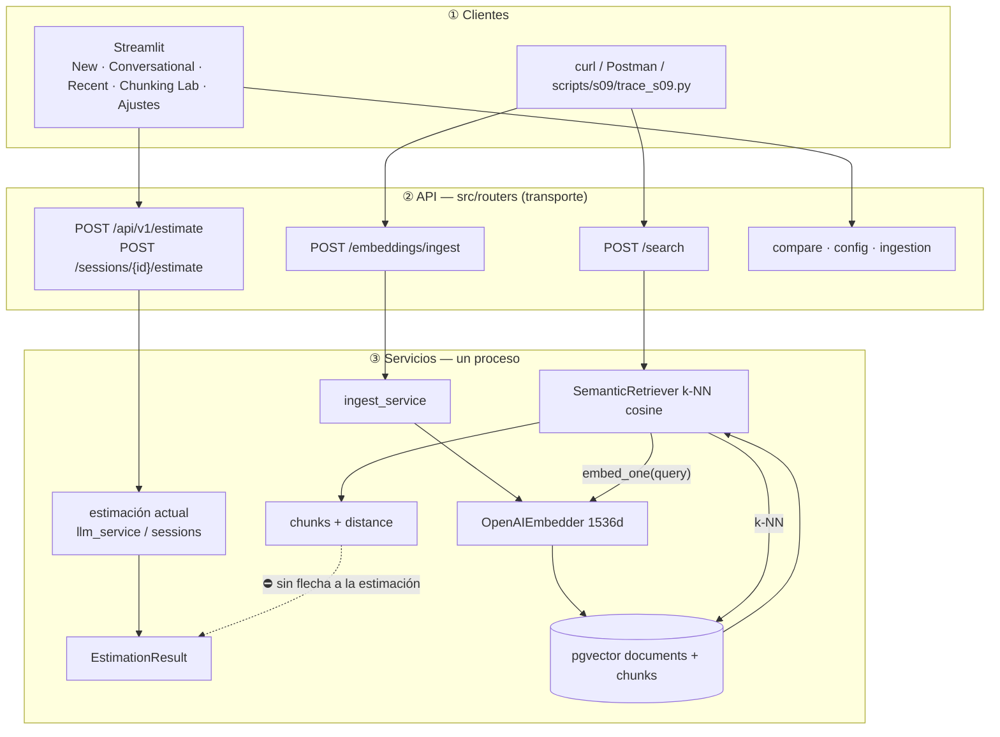

# Pre-sesión 9 — diagnóstico arquitectónico RAG

This is a writing exercise, not a port. Do not implement product code. Do not bring more files from Lidr. The transcripts, `S09_TEMPLATE.md` and `estimador-cag/scripts/s09/trace_s09.py` are already in our tree. Do not start a step until the previous one is ticked.

This file is the handoff. Closed plans (`pre-sesion8_plan.md`, `sesion8_port_plan.md`, …) are read-only.

## Handoff (start here)

| | Path / value |
|---|---|
| Ours | `/home/morales4dev/wsTakeoff/ai-engineering` branch `session-09/pre-work` @ `fecc648`, app `estimador-cag/` |
| Reference | `/home/morales4dev/wsTakeoff/ai-engineering-lidr` `origin/session_09` @ `bd231b2`. Quarry is closed. Their solved `arquitectura-actual.md` is **not** a source. |
| Deliverable | `ai-engineering/arquitectura-actual.md` (git root, same place as Lidr). Filled from `examples/transcripts/S09_TEMPLATE.md`. |
| Trace script | `estimador-cag/scripts/s09/trace_s09.py` (client only: OpenAI embed + `POST /search`). |
| Transcripts | `ai-engineering/examples/transcripts/{01_clear,02_ambiguous,03_hard}.txt`. Trace uses `02_ambiguous.txt`. |
| Seed leftovers | `estimador-cag/data/seed/transcripts/` are S06 fixtures. Do not use them. |
| Stack | Compose already up. `/health` healthy. Corpus after cleanup: **17** `historical_budget`, **60** `budget_component`. No synthetic rows. |
| Front | Streamlit tabs: New / Conversational / Recent / Chunking Lab / Ajustes. No search tab. Same gap as Lidr Rails. |

## Already done (do not redo)

- Deleted `synthetic_test` (30k lab chunks). CASCADE left the 17 budgets.
- Copied the three transcripts + `S09_TEMPLATE.md` to `ai-engineering/examples/transcripts/`. Script is `estimador-cag/scripts/s09/trace_s09.py`.

## Locked

- PDF = exercise (four sections, real trace, five verifiable failures). Lidr solved doc = off limits for content.
- No new endpoints, no query rewrite, no reranker, no generation module, no Streamlit search tab. If you are writing Python that is not a one-off client call, stop.
- Do not copy IBM / “Query → Retrieval → Augmentation → Generation” as the section 4 diagram. Boxes come from **our** failures.
- Do not invent distances, norms, or chunk ids. Paste the live output.
- Observations in Spanish. Commands, payloads, field names in English.
- Do not re-open the section 1 shape. It is below.
- README pointer at git root so the deliverable is findable. `evolution.md` gets one `pre_sesion_09` event (doc only, no product change).

## Locked — sección 1 diagram (do not re-debate)

The architecture we are diagnosing is **RAG**. One deployable FastAPI process. Not Lidr’s Rails-business / FastAPI-IA split. Streamlit is a client, not a business backend.

Draw **what exists**, including the current estimate path (Streamlit → FastAPI → LLM → `EstimationResult`). Do not label that path as a second architecture. Also draw the RAG endpoints and modules **even though nothing calls them from the estimate path**. No arrow between the two.

Three rows:

1. **Clientes** — Streamlit for the tabs that exist (New / Conversational hit estimate; Chunking Lab hits compare; no search tab). Same row: generic HTTP client (`curl` / Postman / `scripts/s09/trace_s09.py`) for `/search` and `/embeddings/ingest`.
2. **API** — `src/routers/` (transport only). Show estimate/session endpoints **and** the RAG ones (`POST /embeddings/ingest`, `POST /search`). Other surfaces (`compare`, `config`, ingestion) can sit as extra API boxes.
3. **Servicios (mismo proceso)**
   - Estimación actual: `llm_service` / sessions → `EstimationResult`. Not fed by `/search`.
   - RAG: ingest → embed → store → `/search`. Output: chunks + cosine `distance`. Does not call estimation.

Shade two facts, not a missing product: (a) RAG dies at “lista de chunks”; (b) the estimate Streamlit already shows is not built from those chunks. Do not draw the retrieval → estimate arrow here (section 4).

Do not use PDF names (`ingest/`, `embedding_pipeline/`, `storage/`). Use our modules.



---

## Step 1 — Diagrama de lo que existe

Resumen: dibujar el sistema real al cierre de S08, con la forma locked de arriba. Aquí no se inventa nada nuevo; solo se pasa ese mermaid al entregable y se escribe la lectura en español.

- Create `ai-engineering/arquitectura-actual.md` from `examples/transcripts/S09_TEMPLATE.md` (copy the skeleton, do not fill 2–4 yet).
- Paste the locked mermaid into section 1. Add a short reading paragraph: Streamlit already gets an estimate from FastAPI; the RAG endpoints (`/embeddings/ingest`, `/search`) exist and are drawn; they are not wired to that estimate; the path dies at a chunk list.
- Name real modules and real endpoints. Mark where implementation ends.

**Acceptance:** section 1 exists, distinguishable from an empty template, no “future” boxes, no Rails, no PDF folder names.

**Stop.** Tick. Wait.

## Step 2 — Trace vivo de `02_ambiguous.txt`

Resumen: ejecutar el sistema tal cual contra la transcripción ambigua y pegar la salida real. Sin esto el resto del documento es opinión.

From `ai-engineering/` (stack up, `OPENAI_API_KEY` on the host — step 1 of the script talks to OpenAI directly; `/search` re-embeds inside the API):

```bash
export OPENAI_API_KEY=sk-...
    uv run estimador-cag/scripts/s09/trace_s09.py examples/transcripts/02_ambiguous.txt
```

Equivalent search-only curl (the script already does this):

```bash
curl -s -X POST http://localhost:8000/search \
  -H "Content-Type: application/json" \
  --data-binary @- <<'JSON'
{"query": "<full text of 02_ambiguous.txt>", "k": 5}
JSON
```

- Fill section 2 paso 1: command, dimensionality, L2 norm, first and last component, 1–2 sentence comment on what that single vector represents given Casa Castaño’s mixed intents.
- Fill section 2 paso 2: command + raw JSON (chunks, `distance`, `metadata`).
- If `/search` is empty, stop and say so. Do not invent hits. Corpus should be 60 chunks; do not re-ingest unless it is actually empty.
- Do not delete or add rows. The exercise is embed → search. Do not add other HTTP calls to the trace.

**Acceptance:** commands are runnable as pasted; numbers are from this run, not from Lidr, not from `output_examples.txt`.

**Stop.** Tick. Wait.

## Step 3 — Lectura de chunks + cinco fallos

Resumen: mirar los 5 hits con honestidad y escribir solo fallos que se puedan señalar en esa salida. Si un chunk es bueno, se dice; si no, también.

- Section 2 paso 3: for each hit — `budget_id`, `client_sector`, hours if present, relevant to Casa Castaño (tienda gourmet → web + puntos + panel + pago con tarjeta)? Yes / partial / no, and why.
- Section 3: five failures. Each = Problema observado (cite the trace) / Causa probable / Propuesta de solución (what piece, not how to code it).
- Concrete and checkable. “El sistema no es bueno” is not a failure. If you have more than five, park the rest under `### Otros`.
- Allowed to use facts already measured without the trace: `/search` has no metadata `WHERE`; no encode endpoint (embed happens inside search); chunk = component, not budget rollup; nothing after `/search` assembles or generates an estimate. Still: at least one observation per failure must point at section 2 when the trace speaks to it.
- Do not paste Lidr’s five titles.

**Acceptance:** a reader can match each failure to a line in the pasted JSON or to a cited contract in our repo.

**Stop.** Tick. Wait.

## Step 4 — Evolución (sección 4)

Resumen: segundo diagrama, mismas tres filas, cajas nuevas marcadas, salidas de los fallos del paso 3. Un párrafo corto; la pieza crítica es la que atacarías primero.

- Same client / API / services layout as section 1 (estimate box + unconnected RAG endpoints) so the two figures are comparable.
- Mark new boxes. Do not redraw a textbook RAG pipeline unless that box is the fix for a named failure.
- Paragraph ≤ 10 lines: responsibility of each new box, data between them, which one you would build first and why (grounded in the trace, not in the slogan “augmentation”).

**Acceptance:** section 1 and section 4 are visually distinct; a reader can see what was added; no greenfield rewrite of Streamlit or of the existing RAG modules.

**Stop.** Tick. Wait.

## Step 5 — Cerrar entregable + dónde está

Resumen: dejar el markdown en la raíz del git y una frase en el README para que no se pierda. Nada de código de producto.

- Confirm `ai-engineering/arquitectura-actual.md` has all four sections filled.
- `ai-engineering/README.md`: one short pointer to that file (Sesión 09 pre-work). Do not rewrite `estimador-cag/README.md`.
- `estimador-cag/docs/evolution.md`: add event `pre_sesion_09` and one row — diagnostic doc, no product change. Do not mark S08 rows superseded.

**Acceptance:** opening the git root shows `arquitectura-actual.md`; the root README says so; evolution has the event.

---

## Summary

| # | Title | OK |
|---|---|---|
| 1 | Section 1 diagram (locked shape) into `arquitectura-actual.md` | [ ] |
| 2 | Live trace of `02_ambiguous.txt` pasted | [ ] |
| 3 | Chunk reading + five trace-anchored failures | [ ] |
| 4 | Section 4 evolution from those failures | [ ] |
| 5 | Root README pointer + `evolution.md` event | [ ] |

Done. Deliverable is `arquitectura-actual.md` at the git root.

## Out of this plan

- Any product code (routers, retriever, Streamlit, prompts, generation).
- Copying Lidr `arquitectura-actual.md` or their section-4 boxes.
- Bringing more files from Lidr.
- Re-inserting synthetic chunks.
- `docker compose down -v`.
- Connecting `/search` to the estimate path in section 1 (that arrow is section 4, if the failures justify it).
- Inventing distances.
- Debating the section 1 shape again.
